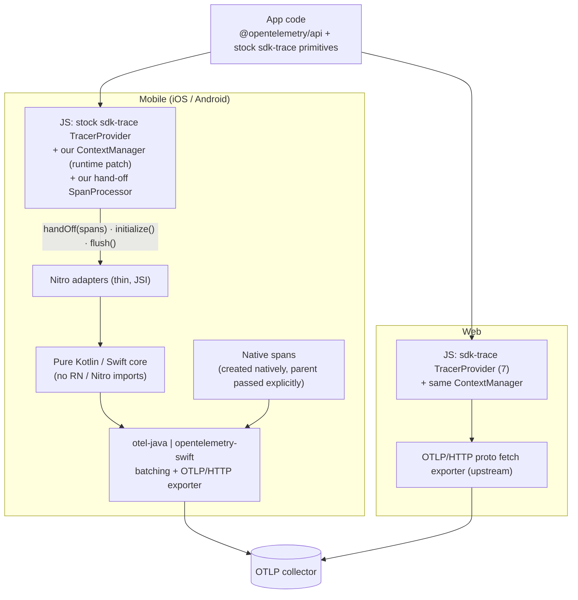
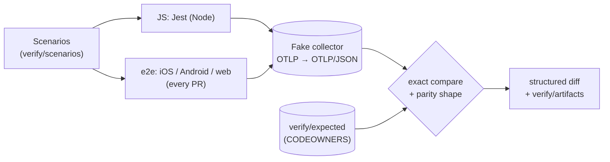
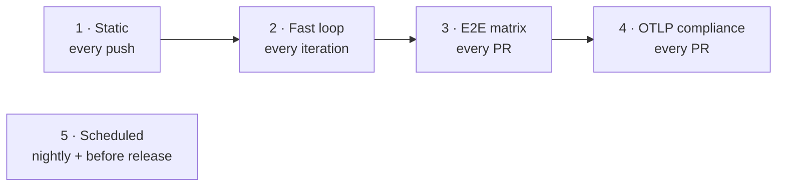

# React Native OpenTelemetry SDK — v0 design

Date: 2026-11-10 · Status: reviewed (builder check + 3-member council), awaiting author approval
Author: Adam Horodyski (with Claude)

The existing code in this repo (v0.2.0) was a scratch approach. This design starts over;
nothing in `src/`, `android/`, `ios/` needs to be preserved, though the example app and
`example/collector/` can be reused.

Decisions are marked **(decided)** when the author made them, **(Claude's call)** when they
were proposed by Claude and not explicitly confirmed. Builders may revisit Claude's calls.
Section 13 lists every Claude's call in one place.

---

## 1. Intent

Build a universal OpenTelemetry distribution for React Native (bare and Expo, iOS and
Android) with a web story through the same API. It should:

- plug into any RN project with minimal setup,
- be fast (heavy work — encoding, batching, network, persistence — happens natively),
- reuse OpenTelemetry org building blocks wherever they exist,
- produce traces whose parent/child structure is a faithful cause-and-effect record of
  what happened in the app,
- be OTLP compliant, so any compliant backend (Grafana, Honeycomb, Jaeger, …) can read it.

React-idiomatic APIs and auto-instrumentations are the long-term UX goal, but **not v0**.

### v0 goal (decided)

A vertical slice: everything essential to set the SDK up and get telemetry, **with correct
nesting**, to a collector — on iOS, Android and web.

## 2. Goals, non-goals, anti-goals

**Goals (v0)**
- SDK init on Android and iOS (native-first, with a JS fallback); JS attaches to it.
- JS spans created with the stock OTel JS SDK, exported through the native pipeline.
- Correct nesting: children nest under their causal parent through `await`, promise and
  timer flows; concurrent work never leaks into another trace.
- Parenting across the JS↔native boundary in both directions.
- Web: same JS call, upstream browser SDK, direct export.
- An AI-native verification pipeline (section 9).

**Non-goals (v0)** — see the v1 backlog (section 11).
- Auto-instrumentations (press, network, navigation, lifecycle, render, long tasks).
- React-specific APIs (hooks, providers, `trace()` helpers, `'use trace'`).
- Sessions, sampling config, disk buffering, runtime header updates, enable/consent switch.
- Cross-platform data-shaping processors (`attributes`, `filter`, `redaction`).
- Logs and metrics signals. Old architecture (New Architecture only).

**Anti-goals** (would make this a failure even if it technically works)
- A span attached to the **wrong parent** through `await`, promise or timer flows. Losing a
  parent (span becomes a root) is acceptable degradation. Shared queues and intervals are
  handled by the documented policy in section 6.2, not left to chance.
- Vendor-specific attribute names where a semantic convention exists; anything in the
  reserved `otel.*` namespace.
- Leaking vendor SDK types (otel-java, otel-swift) into the JS↔native seam or into
  client-facing APIs — it would block swapping native implementations later (e.g. to C++).
- Forking or reimplementing an OTel building block that already exists upstream.

## 3. Constraints and context

- RN New Architecture, Hermes. Research was done against RN 0.84–0.88 / Hermes V1.
  Minimum supported RN version: builder's choice, but upstream OTel JS 3.x requires
  Metro ≥ 0.81.3 (RN ≥ 0.79) for `package.json` `imports` resolution, and Nitro requires
  RN ≥ 0.75.
- Upstream versions at time of writing: `@opentelemetry/api` 1.10, OTel JS stable 3.1.x /
  experimental 0.301.x (`@opentelemetry/sdk-trace` replaced `sdk-trace-base`/`-web` in 3.0),
  `@opentelemetry/browser-sdk` (lives in `open-telemetry/opentelemetry-browser`, pre-1.0),
  otel-java (stable), opentelemetry-swift 2.6.
- Nitro Modules 0.37.x (pre-1.0). Requires Xcode ≥ 27.0 (the opentelemetry-swift 2.6 dependencies need Swift 6.4), NDK ≥ 27. Pin the supported range
  and document it; `react-native-nitro-modules` is a peer dependency the app installs.
- Bare RN and Expo must both work. Expo config plugins only run in `expo prebuild`, so
  nothing essential may depend on a plugin.
- opentelemetry-swift appears to be distributed via SwiftPM only (no podspec at repo
  root — reported by a reviewer, builder to confirm). The pod must pull it via
  `spm_dependency` (RN ≥ 0.75) or vendor it; verify with Xcode 27.0, static frameworks and
  Nitro's Swift/C++ interop.

## 4. Architecture (decided)

Code sketches in this document are **illustrative**: they show intent and shape, not exact
signatures. Diagrams are Mermaid.



| Ours vs upstream | |
|---|---|
| upstream, reused as-is | `@opentelemetry/api`, `sdk-trace`, otel-java, opentelemetry-swift, exporters |
| ours | ContextManager patch, hand-off processor, Nitro adapters, pure native core, Metro helper |

### 4.1 Where spans live (decided: "option C")
- **JS spans live in the stock JS SDK** (`@opentelemetry/sdk-trace` `TracerProvider`) on both
  mobile and web, so all upstream JS primitives work unchanged: `SpanProcessor`, `Sampler`,
  `InMemorySpanExporter`, `registerInstrumentations`.
- **Native spans live in the native SDK** and never pass through JS.
- Parent/child relationships across sides are carried purely by IDs (`traceId`,
  `parentSpanId`); the backend rebuilds the tree regardless of which side exported a span.
- **Hand-off entry point (Claude's call, from review):** JS spans enter native at the
  **batching/export stage**, as native `SpanData` (Java: implement the `SpanData`
  interface; Swift: construct the `SpanData` struct), enqueued into the native batch
  processor / exporter. They are **not** faked as live native spans (otel-java's
  `SpanWrapper` is package-private; Swift's `ReadableSpan` extends the full `Span`
  protocol). Consequence: custom native `SpanProcessor`s do not see JS spans; JS spans are
  processed by JS processors. Anything that must apply to all spans (v1 data-shaping specs)
  is implemented as a native exporter wrapper, which does see both. The repo's history
  (commit `fe4d4b8`, removed `exportTraces`) has an earlier Kotlin version of the conversion.
- **Hand-off cadence (Claude's call, revised in council review 2026-11-21):** one
  **synchronous void** Nitro call per ended span from our JS `SpanProcessor.onEnd`, but the
  seam is **batch-shaped**: `handOff(spans: SeamSpan[])`, called with one span in v0. If
  measurement later says to batch (e.g. microtask coalescing), that is a JS-only change: no
  seam change, codegen or fixture rewrite. On the JS thread native only copies the struct
  and enqueues; parsing IDs, building attributes (int/double rule) and `SpanData` happen on
  the native export thread. JS keeps no buffer, so a JS reload or crash doesn't lose ended
  spans.
- Considered and rejected: native owns all spans with a JS proxy (Embrace's model). It
  loses JS `SpanProcessor`s on mobile, adds a JSI call per span operation, and risks leaked
  unended native spans.

Life of a JS span on mobile:

```mermaid
sequenceDiagram
  autonumber
  participant App as App code (JS)
  participant SDK as sdk-trace (JS)
  participant HP as Hand-off processor (JS, ours)
  participant N as Nitro adapter
  participant Core as Kotlin/Swift core
  participant V as otel-java / otel-swift
  participant C as Collector
  App->>SDK: tracer.startSpan('work')
  Note over SDK: plain JS object; JS processors' onStart run here
  App->>SDK: span.setAttribute(...) / span.end()
  SDK->>HP: onEnd(ReadableSpan)
  HP->>N: handOff([spanStruct])  [sync, void]
  N->>Core: convert (no RN types past here)
  Core->>V: enqueue SpanData into native batch processor
  Note over V: background thread
  V->>C: OTLP/HTTP (protobuf), retries
```

The hand-off processor, roughly:

```ts
// illustrative
class NativeHandOffProcessor implements SpanProcessor {
  onStart() {}
  onEnd(span: ReadableSpan) {
    if (!(span.spanContext().traceFlags & TraceFlags.SAMPLED)) return;
    native.handOff([toSeamStruct(span)]); // HrTime, typed attributes, scope, parent
  }
  forceFlush() { return native.flush(); }
  shutdown() { return native.flush(); }
}
```

### 4.2 Native core and the seam
- A native core per platform holds all native logic (span hand-off → `SpanData`, SDK
  setup, export config, the native parenting helper); the Nitro HybridObject is a thin
  adapter over it.
  - Android: the core (`android/src/main/java/com/callstack/otel/core`) reads Nitro's
    generated seam structs directly; no hand-kept copy of the seam types. Core depends on
    `opentelemetry-sdk` and the OTLP exporter.
  - iOS: the core (`ios/Core/*.swift`) takes opentelemetry-swift types only. Nitro's
    generated Swift structs are typealiases of C++ structs, so code using them needs C++
    interop, and the core must not (below): the Nitro adapter pod builds `SpanData` from
    the seam structs and hands the core `ReadableSpan`s. *(R24, Task 25: the app's non-interop Swift `AppDelegate` cannot import a Nitro C++-interop module, so iOS ships
    two pods: pure-Swift `ReactNativeOpenTelemetryCore` (`ios/Core` + `RNOtel`) and the Nitro adapter pod that
    depends on it. Autolinking links one podspec per package, so apps add `pod 'ReactNativeOpenTelemetryCore',
    :path => '../node_modules/react-native-open-telemetry'` to their Podfile.)*
- **v0 uses otel-java directly, not opentelemetry-android** (Claude's call): otel-java is
  stable; opentelemetry-android is alpha, adds desugaring/AGP constraints, and v0 needs none
  of its instrumentation. Add it with v1 lifecycle work. Watch OkHttp version alignment
  with RN's own OkHttp.
- The **Nitro spec uses only OTel-neutral shapes** (decided): `SpanContext`
  `{traceId, spanId, traceFlags, traceState}`, span kind, status, typed attribute values,
  times, events, links, instrumentation scope (name, version, `schemaUrl`). No Java/Swift types.
- Kotlin/Swift is the starting implementation; parts may move to C++ later
  (opentelemetry-cpp was evaluated: stable, but heavy for mobile — libcurl + protobuf +
  abseil — and has no mobile instrumentation). The seam rule keeps that move invisible.
- Nitro is kept (decided earlier) for Swift/Kotlin without an ObjC++ shim, typed attribute
  value variants, and zero-copy `ArrayBuffer`. Keep the v0 spec **callback-free**: no
  native→JS callbacks or event emitters.

### 4.3 The seam in detail (v0)
Exact shapes are the builder's, within the seam rule. A sketch of the Nitro spec:

```ts
// illustrative: src/specs/Otel.nitro.ts
type HrTime = number[]; // [seconds, nanos]; Nitro/Swift rejects tuples (swiftlang/swift#75865)
interface SeamSpanContext { traceId: string; spanId: string; traceFlags: number; traceState?: string }
type AttrValue = string | number | boolean | string[] | number[] | boolean[];
interface SeamAttribute { key: string; value: AttrValue }
interface SeamSpan {
  context: SeamSpanContext; parentSpanId?: string; name: string; kind: number;
  start: HrTime; end: HrTime; attributes: SeamAttribute[];
  events: { name: string; time: HrTime; attributes: SeamAttribute[] }[]; // named interfaces (SeamEvent, SeamLink, SeamStatus, SeamScope) in code: Nitro rejects anonymous objects
  links: { context: SeamSpanContext; attributes: SeamAttribute[] }[];
  status: { code: number; message?: string };
  scope: { name: string; version?: string; schemaUrl?: string; attributes: SeamAttribute[] };
}
interface Otel extends HybridObject<{ ios: 'swift'; android: 'kotlin' }> {
  initialize(config?: SeamConfig): { alreadyInitialized: boolean; testMode: boolean; error?: string }; // idempotent
  handOff(spans: SeamSpan[]): void;              // sync, one span per ended span in v0
  flush(timeoutMs: number): Promise<void>;
}
```

No `io.opentelemetry.*` or OpenTelemetrySdk types appear here; every field maps 1:1 to the
OTel data model.
- `initialize(config?)` — sync, idempotent. Returns `alreadyInitialized: true` when native
  init already ran (config ignored), and `error` when init failed (e.g. an invalid URL) or
  when native isn't initialized and no config was given. It replaces the earlier
  `getResource()`: JS never needs native's resource, because JS spans are exported with it.
- `handOff(spans)` — sync void (4.1).
- `flush()` — Promise; flushes JS processors, then native export, with a timeout. Must never
  block the main thread; must resolve safely after a JS runtime reload.
- **Background flush:** native flushes when the app goes to background, without blocking:
  asynchronously on Android (`ProcessLifecycleOwner` `ON_STOP`, never `join()` on the main
  thread), inside `beginBackgroundTask`/`endBackgroundTask` on iOS so the request isn't
  suspended mid-flight.
- **Times** cross the seam as OTel's `HrTime` shape, `[seconds, nanos]` (two numbers),
  because epoch nanoseconds (~1.7e18) exceed what a JS number holds exactly. Known floor:
  Swift `SpanData` stores times as `Date` (≈ sub-µs quantization); document it.
- **Attribute typing:** JS can't tell `1` from `1.0`. Follow the OTLP JS transformer's rule
  (`Number.isInteger` → int) on the native side too, so platforms agree. Values outside
  `AttrValue` (null, nested objects, bytes, mixed or null-containing arrays) are dropped at the
  seam in v0.
- **Cross-boundary parenting:**
  - **JS → native**: native work started on behalf of JS takes a `SpanContext` (or a
    `traceparent` string) and starts its span with an **explicit parent**
    (`spanBuilder.setParent(...)`), `isRemote = false`. Never rely on native thread-local
    "current context". v0 ships a small public native helper (Kotlin + Swift) so app native
    code can do this, plus a test-only HybridObject in the example app that exercises it.
    **(Claude's call.)**
  - **Native → JS**: native returns the `SpanContext` of a native span; JS wraps it as a
    non-recording parent (`trace.wrapSpanContext`) and starts children under it.

  ```mermaid
  sequenceDiagram
    participant JS as JS (inside span A)
    participant AppNative as App's native module
    participant Helper as Our native helper
    participant V as Native SDK
    JS->>AppNative: doWork(traceparent of A)
    AppNative->>Helper: contextFrom(traceparent)
    Helper->>V: spanBuilder("native.work").setParent(A, isRemote=false)
    V-->>AppNative: span B (child of A)
    AppNative-->>JS: result + SpanContext of B
    Note over JS: trace.wrapSpanContext(B) → children of B in JS
  ```

  ```kotlin
  // illustrative: app native code using our helper
  fun doWork(traceparent: String): String {
    val span = RNOtel.tracer("com.acme.native").spanBuilder("native.work")
      .setParent(RNOtel.contextFrom(traceparent))   // explicit parent, never thread-local
      .startSpan()
    try { /* work */ } finally { span.end() }
    return RNOtel.traceparentOf(span)               // hand B back to JS
  }
  ```

  ```ts
  // illustrative: JS side
  const childCtx = await tracer.startActiveSpan('A', async (a) => {
    const tp = native.doWork(toTraceparent(a.spanContext()));
    return trace.setSpan(context.active(), trace.wrapSpanContext(fromTraceparent(tp)));
  });
  context.with(childCtx, () => tracer.startSpan('js.after_native').end()); // child of B
  ```
- **Sampling (v0 default, Claude's call):** `ParentBased(AlwaysOn)` on both sides; both
  honor the `traceFlags` passed across, so a non-sampled parent never yields shipped
  children on the other side. Configurable sampling is v1.
- **Resource identity (Claude's call):** one resource, owned by native. JS spans exported by
  native carry it; JS does not add its own `telemetry.sdk.*` values. Our SDK identifies
  itself with the semantic-convention distro attributes `telemetry.distro.name` /
  `telemetry.distro.version` (`telemetry.sdk.*` stays otel-java / opentelemetry-swift's).
  Carry `schemaUrl` for resource and scope.
- **Clock (Claude's call, simplified in council review and again in v0 implementation):** both
  sides use wall-clock epoch time. JS keeps upstream `sdk-trace` timing: each span starts at
  `Date.now()` and measures its duration with `performance.now()`; there is no extra JS offset
  (sdk-trace 3.1 has no time-source hook). Error between JS and native siblings is under 1 ms;
  scenarios use explicit timestamps, so test output is unaffected.
- **Before native is ready / failures (Claude's call):** no pre-init buffer. `initialize`
  runs synchronously inside `startReactNativeSdk` before the JS provider is registered, so
  no span can end before native is ready; spans started earlier come from the API's no-op
  provider. Native init failure, or a missing native module (Expo Go), is reported once,
  loudly (`console.error`), and `startReactNativeSdk` returns a working no-op handle. The
  SDK never throws into the app.
- **Multiple runtimes (Claude's call):** one native singleton; `initialize` is safe under
  concurrent calls; each JS runtime has its own hand-off. Per-runtime
  attributes are out of scope for v0.

### 4.4 Configuration (decided: "option A", with JS fallback)
- **Mobile, preferred**: config lives in **one native init call** in
  `MainApplication.onCreate` / `AppDelegate` (endpoint, static headers, service
  name/version, resource attributes). Native starts before JS (needed later for app start
  and early crashes). Guard Android init to the main process.
- **Mobile, fallback (decided)**: `startReactNativeSdk(config)` initializes native itself
  when no native init happened (Sentry does the same). This is the path for Expo managed
  apps without a config plugin; it loses only pre-JS capture. Prior art: §14 P7.
- When native init did happen, `startReactNativeSdk({...})` attaches; JS export config is
  ignored with one warning.
- Returns `{ tracerProvider, forceFlush(), shutdown() }`, the names OTel JS uses on every
  provider and SDK. On mobile `shutdown` stops only the JS provider, never the native
  singleton. The returned `tracerProvider` is the one registered globally.
- Missing or invalid config logs one error and returns a no-op handle (as browser-sdk does
  with `invalidConfig`); it never throws.
- **Endpoint (`exportConfig.url` / native `url`)** means the same on every platform: the
  OTLP/HTTP traces endpoint (e.g. `https://collector:4318/v1/traces`), used as given. No path
  is appended.
- **Web**: the same call takes exporter options, mirroring `startBrowserSdk`'s option names
  (`serviceName`, `serviceVersion`, `resourceAttributes`, `exportConfig: { url, headers }`,
  `instrumentations`, …).
- Option names mirror upstream (`startBrowserSdk`, declarative config schema) wherever
  upstream has a name. Rejected: OTel declarative config YAML (not supported by
  opentelemetry-swift or opentelemetry-android); a build-time baked config file (sugar).
- Native init is our own thin API wrapping the vendor SDKs; clients never call vendor
  builders directly. iOS and Android each declare config in their own language; accepted.

Usage, roughly (names are placeholders):

```kotlin
// android: MainApplication.onCreate — preferred, native-first
RNOtel.start(this) {
  serviceName = "shop"; serviceVersion = BuildConfig.VERSION_NAME
  export { url = "https://collector.example.com:4318/v1/traces"; headers = mapOf("x-api-key" to KEY) }
  resourceAttributes = mapOf("deployment.environment.name" to "prod")
}
```

```swift
// ios: AppDelegate — preferred, native-first
RNOtel.start { c in
  c.serviceName = "shop"; c.serviceVersion = Bundle.main.version
  c.export = .init(url: "https://collector.example.com:4318/v1/traces", headers: ["x-api-key": KEY])
}
```

```ts
// index.js (mobile + web). With native init: attaches. Without (Expo managed): initializes.
import { startReactNativeSdk } from 'react-native-open-telemetry';
startReactNativeSdk({
  // only needed on web, or as the mobile fallback when no native init ran:
  serviceName: 'shop',
  exportConfig: { url: 'https://collector.example.com:4318/v1/traces', headers: { 'x-api-key': KEY } },
  spanProcessors: [/* stock sdk-trace SpanProcessors, unchanged */],
});
```

```js
// metro.config.js: installs the context patch before any app module
const { withOtel } = require('react-native-open-telemetry/metro');
module.exports = withOtel(getDefaultConfig(__dirname));
```

### 4.5 Naming (decided)
1. Semantic conventions first, with `schemaUrl` set on tracers. Runtime code imports only
   the stable `@opentelemetry/semantic-conventions` entry; incubating keys are inlined as
   constants (Metro doesn't tree-shake, so `/incubating` would ship every key).
2. Instrumentation scope (tracer name + version) identifies which component produced a span.
3. Only concepts with no convention get custom names, prefixed `com.callstack.*`
   (OTel naming guidance: reverse-domain prefix; `otel.*` is reserved). **Prefix is
   Claude's call.**

Package name: `react-native-open-telemetry` (subpath `/metro`). Entry function:
`startReactNativeSdk`, on web too. **(decided)**

## 5. Trace model (decided; most of it lands with v1 instrumentations)

Recorded so v0 primitives don't preclude it:
- Spans nest by **cause and effect**, not by temporal overlap.
- One trace per trigger (a tap, a navigation, a timer). Session and screen are attributes,
  never parent spans.
- Renders caused by several interactions get **links** to each cause, not a parent.
  **(Claude's call.)**
- Work with lost context may be attributed by time window in v1, but must be visibly
  marked as heuristic. **(Claude's call.)**

## 6. Context propagation (decided)

### 6.1 Mechanism
1. **Runtime patch.** Our `ContextManager` **extends upstream `StackContextManager`** from
   `@opentelemetry/sdk-trace` (Claude's call: reuse, don't reimplement) and adds wrappers on
   `Promise.prototype.then`, `setTimeout`, `setImmediate`, `queueMicrotask`,
   `requestAnimationFrame`: capture the active context when a callback is scheduled, restore
   it when it runs, restore the previous one after. RN's Babel preset compiles `await` to
   `Promise.resolve(x).then(...)`, so `await` is covered. The spike's `runtime.js` is the
   reference. `context.setGlobalContextManager` is called once, before any API use.
   Prior art: zone.js, async-listener (§14 P1–P3).
   **ROOT fast path (council review):** every wrapper restores in `finally`, so each job
   taken from the microtask or timer queue starts at ROOT; a callback registered at ROOT
   can use the original `then` unwrapped. Most `then` calls in an app (startup, data
   libraries) happen with no span active, so this removes most of the patch's cost.
   `root-no-leak` and `concurrent-interleaved` guard it.

   ```ts
   // illustrative, ~40 lines in full
   class RNContextManager extends StackContextManager { /* exposes a swap(ctx) primitive */ }
   const cm = new RNContextManager();

   const wrap = (ctx, fn) => function (v) {     // fixed arity: no rest array, no apply
     const prev = cm.swap(ctx);                 // enter the context it was scheduled in
     try { return fn.call(this, v); } finally { cm.swap(prev); } // always restore
   };

   const then = Promise.prototype.then;
   Promise.prototype.then = function (ok, err) {
     const ctx = cm.active();                   // capture at registration
     if (ctx === ROOT_CONTEXT) return then.call(this, ok, err); // fast path: nothing to carry
     return then.call(this, ok && wrap(ctx, ok), err && wrap(ctx, err));
   };
   for (const name of ['setTimeout', 'setImmediate', 'queueMicrotask', 'requestAnimationFrame']) {
     const orig = globalThis[name];
     globalThis[name] = (cb, ...rest) => orig(typeof cb === 'function' ? wrap(cm.active(), cb) : cb, ...rest);
   }
   // setInterval: ticks run in ROOT_CONTEXT (6.2), not wrap(cm.active())
   context.setGlobalContextManager(cm);
   ```

   Why `await` is covered, as RN compiles it:

   ```ts
   // source                         // what RN's Babel preset emits (simplified)
   async function f() {              function f() { return _asyncToGenerator(function* () {
     await g();                          yield g();   // → Promise.resolve(v).then(next)  ← patched
     tracer.startSpan('after');          tracer.startSpan('after');
   }                                   })(); }
   ```
2. **Install order.** The patch must run before React / the scheduler capture
   `queueMicrotask`/`setImmediate`. Ship a Metro helper `withOtel(metroConfig)` that adds
   the SDK's setup module via `serializer.getModulesRunBeforeMainModule` — plugin-free, and
   it works for Expo Router where users have no "first line" (Claude's call). Code that
   captured `then` before the patch runs at ROOT (loses parent).
3. **Idempotent under fast refresh**: a marker on `globalThis` prevents stacking wrappers.
4. **Startup probe**: an `await` probe compiled like app code (Metro transforms
   `node_modules`). If context does not survive `await` (e.g. `unstable_preserveAsync` on a
   future Hermes with commit `a9d054c8c9`, or a web bundle without async downleveling), log
   loudly and set `com.callstack.context.degraded=true` as an attribute of the JS tracers'
   **instrumentation scope** (Claude's call: a diagnostic about the SDK, not about the
   work). Not a resource attribute: with native-first init the resource is built before JS
   runs the probe.
5. **Explicit API**: none of our own. Edge cases use upstream `@opentelemetry/api`:
   `context.with(trace.setSpan(...), fn)`, `context.bind(ctx, fn)`, and documented
   `context.with(ROOT_CONTEXT, …)` for init code. Our instrumentations bind context
   explicitly and don't depend on the global patch.

### 6.2 Wrong-parent policy (decided)
The spike showed the patch **can** produce wrong parents through shared queues: a queue
flushed once (React's scheduler, `InteractionManager`, debounce/throttle, store notifiers)
runs everyone's work in the context of whoever enqueued first (spike scenario `h_batching`:
`H2` ran as `H1`). Intervals have a similar problem: a poller started inside a tap keeps
attaching to that tap's trace.

- Guarantee wording: **no wrong parent through `await`, promise and timer flows.**
  Shared queues and `setInterval` are documented exceptions, mitigated by:
  1. `setInterval` ticks run in `ROOT_CONTEXT`: each tick's spans start a **new root**
     instead of inheriting the context that registered the interval. No link in v0 (links
     for ticks come with v1 render links).
- A callback that runs after its parent ended is still that parent's causal child and is
  attached to it; backends show it after the parent's end. (An earlier staleness rule that
  turned old parents into links was cut in council review: custom, no precedent, and it
  required wrapping every tracer.)
- The batching scenario stays in the suite as a documented-exception case with its own
  expected output, not as a silent failure.

What the policy produces:

```
// a poller started inside a tap
tap "Refresh"                                      trace A
  └─ load feed
poll tick #1   (new root)                          trace B   ← not a child of the tap
poll tick #2   (new root)                          trace C
```

### 6.3 Rejected
zone.js / `ZoneContextManager` (replaces the global `Promise` — likely breaks Hermes
rejection tracking/LogBox; DOM-heavy; same native-await blind spot; in maintenance).
A Babel plugin that save/restores context around each `await` as the default (the naive
unctx-style form gives wrong parents; a correct "swap" form exists but adds nothing while
async is downleveled; kept as a v1 opt-in). Future: an `AsyncContext` slot when an engine
ships TC39 AsyncContext (Stage 2).

## 7. Web (decided)

Same `@opentelemetry/api` surface and the same ContextManager; spans live in the JS SDK and
export directly from JS. **Changed in v0 implementation (R7, pending author review):** web
builds its own `sdk-trace` `TracerProvider` + `BatchSpanProcessor` + upstream
`@opentelemetry/exporter-trace-otlp-proto` (fetch), not `startBrowserSdk`. Why:
browser-sdk 0.9.1 takes no `idGenerator` (no `0a` test-mode IDs, so no exact web goldens),
adds `telemetry.sdk.*` to the resource (against 4.3), also starts a Logs SDK, exports JSON
(loses NaN), and returns no `tracerProvider`/`forceFlush` for our handle. The resource is
`service.*` + `resourceAttributes` + `telemetry.distro.*` (outside test mode). `start`
re-registers our context manager if another one took the global slot. The package's
`exports` `browser` condition points Metro web (Expo web) at `index.web.js`.

Web is bundled with Metro (Expo web), with the same `withOtel` from `/metro` as mobile.
Browsers run `await` natively, which bypasses the patched `then`. **Decided:** web apps
compile `async` down in their bundler — the same mechanism RN uses by default, and what
Angular requires for zone.js (§14 P4). `babel-preset-expo` keeps native `async` on web, so the
app adds `@babel/plugin-transform-async-to-generator` and
`@babel/plugin-transform-async-generator-functions` for the web platform in `babel.config.js`
(README). Without them, the probe reports degraded (lost parents after `await`, never wrong).

```js
// babel.config.js (Expo app, illustrative)
module.exports = api => {
  const web = api.caller(c => c?.platform === 'web');
  return {
    presets: ['babel-preset-expo'],
    plugins: web ? ['@babel/plugin-transform-async-generator-functions', '@babel/plugin-transform-async-to-generator'] : [],
  };
};
```

## 8. v0 scope and sequencing (decided scope; sequencing is Claude's call)

Scope:
1. Native init on Android and iOS (otel-java, opentelemetry-swift): resource, OTLP/HTTP
   exporter with static headers, batching; JS fallback init.
2. JS on mobile: stock `sdk-trace` `TracerProvider` + our hand-off processor.
3. Context: runtime patch, Metro helper, probe + degraded scope attribute, wrong-parent
   policy (6.2).
4. Cross-boundary parenting, both directions, with the native helper.
5. The seam (4.3).
6. Web: upstream browser SDK, same ContextManager, Metro (Expo web).
7. Proof (section 9): on iOS and Android, the example app produces one trace with a JS
   root, a child after `await`, a native child parented from JS, a JS span parented by
   native; plus a second concurrent trace that shares nothing with the first. On web (no
   native side): the JS root, the child after `await`, and the concurrent trace.

Sequencing (from review; council review 2026-11-21 added step 0):
0. **Tracer bullet:** the real example app with Nitro stubs and the real native
   dependencies linked on both platforms, `handOff` echoing one fixture, and one
   `nest-after-await` e2e test per platform. Proves the seam compiles, the native SDKs link,
   and the e2e tooling can drive the app, before parallel work builds on it.
1. **First milestone: the context patch in a real RN app** (real Hermes, RN's timers,
   Promise, scheduler, `InteractionManager`) with real `sdk-trace` spans. Scenarios include
   React batching, `InteractionManager`, intervals, thrown errors in callbacks, EventEmitter
   listeners. The spike only used a stand-in Hermes host.
2. JS-only slice asserting on output with the fake collector.
3. The seam on one platform, with shared payload fixtures and an early device e2e; then
   port to the second platform.
4. Expected-file goldens and parity check on both platforms.
5. Web.

Each step is defined by the list of scenario names that must pass (9.3); the implementation
plan carries those lists.

## 9. Verification (decided)

Principle: we trust upstream SDKs; we verify **our output**. Everything ends in a fake
collector and is compared to expected exporter output. These are output tests, not unit
tests: they don't care about internals, so internals can be rewritten freely.

### 9.1 Scenarios and expected files are the spec
- **One scenario per guarantee, named after it.** `verify/scenarios/nest-after-await.ts`
  pairs with `verify/expected/nest-after-await.<platform>.otlp.json`. The file name is the
  guarantee's ID; no separate registry or coverage check.
- Expected files are the exact **OTLP/JSON** payload (OTLP's JSON encoding: hex trace/span
  IDs, not the generic protobuf JSON base64 mapping). Plain equality; valid OTLP that can be
  POSTed to a collector or viewed in Jaeger as-is. Per-platform files are accepted.
  Prior art: Collector goldens, upstream test hooks (§14 P17–P19).
- **Spec first:** the expected file is written (agent drafts, human reviews) before the code
  that makes it pass. With explicit timestamps and sequential IDs, exact values are
  predictable. `bun verify --update` writes actual output as a draft to review.
- Determinism in **test mode**, enabled by a **build flag** in the example/test apps, never a
  public runtime switch (Claude's call). JS: `process.env.OTEL_TEST_MODE` inlined at bundle
  time; native: Gradle property `otelTestMode` / `OTEL_TEST_MODE=1` at `pod install`. Same
  flag for the bare and Expo apps; no test fields in the public API or the seam config:
  - **explicit timestamps**: v0 scenarios create all spans themselves, so they pass
    `startTime` / `end(t)` explicitly (JS and native), in whole microseconds. iOS cannot
    represent them exactly: opentelemetry-swift exports `Date`, a ~238–256 ns grid, so the `ios`
    files record the quantized values (R22, measured floor in verify/VERIFY.md). Clock stubs (Java `setClock`/`TestClock` in test source sets
    only; Swift `with(clock:)`) are only a fallback for implicit reads.
  - sequential test ID generators, namespaced per side (JS `0a…01`, native `0b…01`) via
    upstream hooks: JS `sdk-trace` `idGenerator`, Java `setIdGenerator`, Swift
    `with(idGenerator:)`.
  - the fake collector merges a scenario's requests into one payload, grouped by resource
    and scope, spans sorted by ID, **attributes and events sorted** (Swift dictionary order
    is random). Reorders, never rewrites.
  - concurrency scenarios are serialized deterministically (JS is single-threaded; native
    spans in scenarios are started synchronously from JS).
- **Shape files and parity**: each scenario has one hand-written, reviewed
  `verify/expected/<scenario>.shape.json` (trace partitions, span names, kinds, parent
  links, link targets, status, attribute keys and types; no IDs or times). Every platform's
  output is reduced to a shape and must equal it, so all platforms agree with each other by
  construction. Shapes are written first; exact per-platform files are then drafted with
  `--update` and reviewed (council review: hand-writing 30+ exact OTLP trees puts the bugs
  in the expected files). Known v0 gap, accepted: opentelemetry-swift 2.6's OTLP encoder never
  writes span/link `flags`, span/link `traceState` or the scope `schemaUrl`, so the `ios` files
  lack them (shapes don't cover them; no encoder reimplementation, see verify/VERIFY.md).
- One non-deterministic smoke scenario per device (production pipeline, no test mode) checks
  the real path still exports.

A scenario and its expected file, roughly:

```ts
// verify/scenarios/nest-after-await.ts (illustrative)
export default scenario('nest-after-await', async ({ tracer, at }) => {   // at(n) = base + n µs
  const root = tracer.startSpan('root', { startTime: at(0) }, ROOT_CONTEXT);
  await context.with(trace.setSpan(ROOT_CONTEXT, root), async () => {
    await Promise.resolve();
    tracer.startSpan('after_await', { startTime: at(1) }).end(at(2));
  });
  root.end(at(3));
});
```

```json
// verify/expected/nest-after-await.android.otlp.json (excerpt)
{ "resourceSpans": [{
  "resource": { "attributes": [{ "key": "service.name", "value": { "stringValue": "verify" } }] },
  "scopeSpans": [{
    "scope": { "name": "verify" },
    "spans": [
      { "traceId": "0a000000000000000000000000000001", "spanId": "0a00000000000001",
        "name": "root", "kind": 1,
        "startTimeUnixNano": "1767225600000000000", "endTimeUnixNano": "1767225600000003000" },
      { "traceId": "0a000000000000000000000000000001", "spanId": "0a00000000000002",
        "parentSpanId": "0a00000000000001", "name": "after_await", "kind": 1,
        "startTimeUnixNano": "1767225600000001000", "endTimeUnixNano": "1767225600000002000" }
    ] }] }] }
```

A failure, as an agent sees it:

```
✗ nest-after-await [android]  span 0a00000000000002 "after_await"
    parentSpanId  expected 0a00000000000001  got (none)
  expected: verify/expected/nest-after-await.android.otlp.json
  actual:   verify/artifacts/nest-after-await.android.otlp.json
  scenario: verify/scenarios/nest-after-await.ts
```

### 9.2 Layers and runners (decided)
The same scenarios run in every layer, fastest first.

| Layer | Runner | Covers | When |
|---|---|---|---|
| JS (Node) | **Jest** + `babel-jest` + `@react-native/babel-preset` | context patch, hand-off (fake Nitro module) | every iteration |
| E2E: iOS, Android, web | **[`e2e`](https://www.npmjs.com/package/e2e)** (agent-device for mobile, Playwright for web) | everything for real: Nitro glue, both init paths, threading, reload, failure paths, browser SDK, Metro helper (matrix in 9.4) | **every PR** once the seam exists (decided) |

- **Why Jest:** it compiles scenarios the way RN does (`await` → `.then`). Bun's test runner
  and Vitest keep native `await`, which bypasses the context patch and makes results wrong
  for the wrong reason.
- **`e2e`**: one config with `ios`, `android` and `web` targets; one test file per scenario
  runs on all three. The example app has a scenarios screen; the test taps a scenario, waits
  for its done marker, and compares the fake collector's output in the same test. No agent
  steps, so no model or API key and fully deterministic. Pin the version (pre-1.0); set
  `E2E_TELEMETRY_DISABLED=1` in CI.

  ```ts
  // verify/e2e/nest-after-await.e2e.ts (illustrative)
  import { test, expect } from 'e2e';
  import { collector, expected } from '../harness';

  test('nest-after-await', async ({ app, screen, target }) => {
    await app.open();
    await screen.getByTestId('scenario-nest-after-await').click();
    await expect(screen.getByTestId('scenario-done')).toBeVisible();
    expect(await collector.flushed()).toEqual(expected('nest-after-await', target.name));
  });
  ```



- **Native cores are proven on devices:** the Kotlin and Swift cores have no host-side test
  runs. The device e2e runs every scenario through the real seam and native core and compares
  against the same `*.android` / `*.ios` expected files.
- **Fake collector**: a small Node OTLP/HTTP receiver decoding protobuf with the official
  `opentelemetry-proto` definitions and producing OTLP/JSON (GitHub macOS runners can't run
  Docker, so no Collector image).
- **No separate Hermes layer:** E2E runs on real Hermes; Jest on Node is the fast loop. The
  future native-`await` case is covered by the probe's unit test; an
  `unstable_preserveAsync` device build is added once a Hermes release ships it.
- E2E needs `10.0.2.2` on Android, cleartext config and iOS ATS local-networking
  allowance, scoped to the example app only.
- **Unit tests** only where logic is subtle and hard to see in trace output: int vs double
  conversion, `HrTime` math, endpoint normalization.
- Scenarios: await chain, timers/microtasks, `Promise.all`/`race`, interleaved concurrent
  work, ROOT leak check, captured `then`, async generators, batching (documented
  exception), `setInterval` (new root), thrown errors in callbacks, never-settling promise
  (no context leak into later work), cross-boundary both ways, one rich span (every
  attribute type, events, links, status) to catch seam drift, `perf-budget` (below).
  The degraded probe is a unit test: a native-`async` step built with `new Function` defeats the patch.
- **Performance guardrail (council review):** one e2e scenario, `perf-budget`, on the
  Android target only: 1,000 spans with 10 attributes each through the real hand-off, and
  10,000 awaits with the patch on vs off (test build flag). It fails only on loose budgets
  (hand-off p50 < 100 µs per span, patch ratio < 3×) so emulator noise doesn't flake;
  numbers go to `verify/artifacts/perf.json`.

### 9.3 Working loop
1. One command: `bun verify` starts the fake collector, runs the layers, compares every
   scenario, prints one report. Identical locally and in CI.
2. Hermetic and deterministic: no network, device or Docker in the fast loop (stages 1–2
   of 9.4). `bun verify` runs stages 1–2; `bun verify --e2e` adds stage 3 locally.
3. Failures print minimal structured diffs (scenario, span, field, expected vs actual, file
   paths); raw payloads saved to `verify/artifacts/`.
4. **Milestones are lists of scenario names** (section 8). A milestone is done when its
   scenarios pass; every earlier scenario keeps passing because `bun verify` runs them all.
   Scenarios not built yet are marked pending (`test.todo`), never deleted.
5. **Protection:** `verify/` is behind `CODEOWNERS`, so an expected file can't be edited to
   make a test pass without the author's review.
6. The Nitro spec can't import vendor types (anti-goal, section 2): it is TypeScript, so
   `tsc` fails on any `io.opentelemetry.*` import; no separate check.
7. `VERIFY.md` explains layers and failure meanings; `CLAUDE.md` points to it.

### 9.4 The full pipeline (decided)
Everything below is automated; nothing needs a person except reviewing expected files.



| Stage | Runs | Checks |
|---|---|---|
| **1. Static** (seconds) | pre-commit hook, and every push | `tsc`; `oxlint`; Nitro codegen is current (`nitrogen && git diff --exit-code nitrogen/`); `npm pack` contents include `lib/`, `nitrogen/`, `android/`, `ios/`, `Package.swift`, the podspec and the `metro/` helper; unit tests of the fake collector's normalizer (it sorts and merges, so a bug there would hide or invent diffs everywhere) |
| **2. Fast loop** (seconds) | every iteration, local and CI | Jest (Node) through the fake collector against expected files; the handful of unit tests (int vs double, `HrTime`, endpoint) |
| **3. E2E matrix** (minutes) | every PR | `e2e` on five targets: **bare app** (native-first init) on iOS and Android, **Expo prebuild app** (JS-fallback init) on iOS and Android, **web** (the Expo app's Metro web export). All golden scenarios, the failure scenarios below, and one smoke scenario per target without test mode. Parity check across all five outputs. `perf-budget` on Android. |
| **4. OTLP compliance** | every PR, Linux runner with Docker | The fake collector keeps every raw request it received. They are replayed, together with every expected file, to the **official OTel Collector** image (pinned) with an OTLP receiver; the job fails on any rejected request or decode error in its logs. Proves both our output and our spec files are real OTLP. |
| **5. Scheduled** | nightly, and before every release | E2E on the **minimum and latest supported RN**; the fast loop and E2E against the **latest upstream** `@opentelemetry/*`, otel-java and opentelemetry-swift (catches upstream changes before a version bump); the **packed tarball** (`npm pack`) installed into a fresh bare app and a fresh Expo app, running the smoke scenario (catches missing files and broken autolinking). |

Two apps cover both init paths: the bare example inits natively in
`MainApplication`/`AppDelegate`; the Expo app has no native init and relies on the JS
fallback (also the Expo-managed path the spec promises). Both produce the same expected
files, which proves the paths are equivalent.

**PR time budget:** the PR pipeline (stages 1–4) gets a fixed wall-clock budget, set from
the first full green run plus headroom, enforced with GitHub's `timeout-minutes` per job and
one final `needs:` job that checks total wall-clock time. When a PR run exceeds it, the fix is an agent task
(cache native builds, shard targets, trim slow scenarios), never dropping a target: the full
matrix on every PR is decided.

**Releases:** only from commits on `main` whose full PR pipeline and stage 5 passed. Publish
to the `next` dist-tag first; promote to `latest` after the next nightly is green on that
commit.

**Failure scenarios** (E2E; the fake collector can refuse requests on demand):
- collector down: the app doesn't block or crash; spans arrive once it is back.
- native init failure is reported exactly once; the app keeps running with a no-op SDK.
- spans handed off right before the app goes to background are exported without calling
  `flush()`.
- `flush()` resolves, and never blocks the main thread, across a JS reload.
- fast refresh doesn't stack the context patch (same output before and after).

### 9.5 Not covered in v0
- **Performance** beyond the `perf-budget` guardrail (low-end device numbers, Kotlin vs C++
  adapter): the v1 spike (section 11).
- **Memory retention** (a never-settling promise keeping its span alive): output tests
  can't see it; add a `WeakRef` + `--expose-gc` check if it becomes a concern.
- **Multiple JS runtimes**: one native singleton is designed for, not tested.
- **Retry and batching internals** of otel-java and opentelemetry-swift: trusted upstream.
- **Physical devices** and the old architecture.

Left out until needed:

| Left out | Add when |
|---|---|
| Guarantee IDs and a coverage check | too many scenarios to scan the folder |
| Mutant meta-check | a wrong parent once slips past a scenario |
| CI label gate on `--update` | `CODEOWNERS` proves not enough |
| Weaver semconv live-check | v1 instrumentations emit semantic-convention attributes |
| Type tests on the public API | the API stabilizes |
| `bun verify --changed` | the full run gets slow |
| Merge queue re-running the matrix | PRs land concurrently often enough that combined changes break `main` |
| Release gate on real telemetry (a dogfood app reporting through the SDK) | a real app uses the SDK |
| `unstable_preserveAsync` device build | a Hermes release ships commit `a9d054c8c9` |

## 10. Left to the builder
- Repo/package layout beyond 4.2, package manager specifics, exact Nitro spec types,
  minimum RN version, CI provider setup, whether to batch hand-offs (measure first; the
  seam is already array-shaped).
- Whether the fake collector is in-process or a sidecar, as long as it's hermetic.

## 11. v1 backlog
- Spike: Nitro call cost on Android, Kotlin vs C++ HybridObject; context patch overhead on a
  low-end Android device (spike numbers are from an M-series Mac).
- Instrumentations: press (JSX-runtime wrapping of `onPress`, trace root at native touch
  time), network (upstream XHR instrumentation + native OkHttp/URLSession, `traceparent` as
  the JS→native carrier), navigation (React Navigation + Expo Router; consider contributing
  to Apache-2.0 `@embrace-io/react-native-navigation` before forking), lifecycle
  (opentelemetry-android; ~50 lines on iOS), render (Profiler + links), long tasks.
- React API: `trace()`, hooks, possibly a `'use trace'` directive.
- Sessions (`session.id` read per span or on change — native rotates it), sampling
  (declarative-config `sampler` names; parent-based, session-ratio), propagation targets,
  ignored URLs (auto-exclude the OTLP endpoint), enable/consent switch, global attributes
  (incl. pushing `app.screen.name` to native), runtime export headers, diagnostics level,
  span limits, disk buffering.
- Cross-platform data-shaping specs modelled on Collector processors: `attributes`,
  `filter`, `redaction` (data, not code; JS `SpanProcessor` + exporter wrapper on web, native
  exporter wrapper on mobile so it covers JS and native spans).
- Opt-in "swap" Babel plugin for apps that can't downlevel async.
- Links from interval ticks to the context that registered them; webpack helper.
- Native in-memory exporter readable from JS for app teams' tests.
- Expo config plugin (optional, thin, for native-first init), errors/crashes, logs, metrics.
- Native → JS callbacks (avoided in v0 because of Nitro reload hazards).

## 12. Research and evidence
- Context spike (Node + real Hermes 260318099.0.7): the runtime patch passed all scenarios
  except captured `then` (lost parent) and **batching (wrong parent — see 6.2)**; overhead
  ~0.15–0.3 µs per await on an M-series Mac. The naive await plugin gave wrong parents
  (ROOT work seen as an interaction). Native `await` on current Hermes still calls a patched
  `then`; Hermes main commit `a9d054c8c9` will change that. Harness (session-temporary —
  copy into the repo):
  `/private/tmp/claude-501/-Users-adhorodyski-Developer-react-native-open-telemetry/e321df1e-f712-420e-9844-452905422c0b/scratchpad/spike-context/`
- Prior art: Sentry RN (JS spans + native envelope transport, native init with JS fallback,
  no async context), Embrace RN (OTel API facade over native spans, async `spanContext`,
  stack context only), OTel demo RN app (`StackContextManager`, CORS-regex hack),
  Datadog/Faro (time windows).
- Precedent for the runtime patch: zone.js `patchThen` (Angular), async-listener (Node,
  pre-`async_hooks`).
- Upstream code reuse estimate: ~4% of running code is ours (~3.7k of ~89k lines).
- Review: builder check + council (OTel-upstream, RN/native, skeptic) on 2026-11-10.
- CI shape (pre-commit static checks, PR time budget, release only from fully green
  commits, staged release) adapted from
  [Kun Chen on validation categories](https://x.com/kunchenguid/status/2122391325081579618)
  (2026-11-16); the full device matrix stays on every PR by decision.

## 13. Claude's calls (for the author to check)
1. `com.callstack.*` attribute prefix.
2. Pure Kotlin/Swift core modules, and the shared-sources layout (4.2).
3. otel-java directly in v0 instead of opentelemetry-android.
4. JS spans enter native at the batching/export stage; native custom processors don't see
   JS spans (4.1).
5. One sync void hand-off call per ended span through an array-shaped seam; native
   conversion off the JS thread (4.1).
6. `HrTime` `[seconds, nanos]` for times; int-vs-double rule (4.3).
7. Public native parenting helper + test-only HybridObject (4.3).
8. Default sampling `ParentBased(AlwaysOn)` on both sides, honoring `traceFlags` (4.3).
9. One native-owned resource; JS adds no `telemetry.sdk.*`; SDK identity via
   `telemetry.distro.*` (4.3).
10. Clock: upstream sdk-trace timing (start at `Date.now()`, `performance.now()` durations) (4.3).
11. No pre-init buffer; init failure → one error and a no-op handle, never a throw;
    multi-runtime handling (4.3, 4.4).
12. Context manager extends upstream `StackContextManager`; Metro `withOtel` helper for
    install order; ROOT fast path; degraded flag as a scope attribute (6.1).
13. Trace-model rules: links for multi-cause renders, marked heuristic attribution (5).
14. Sequencing, with the real-RN-app context milestone first (8).
15. Test mode as a build flag; explicit whole-µs timestamps in scenarios; attribute/event
    sorting; parity shape; one non-deterministic smoke scenario per device (9.1).
16. Native cores proven by device e2e against the same expected files (9.2).
17. One endpoint meaning on every platform (the traces endpoint, used as given); returned handle `{ tracerProvider, forceFlush, shutdown }` (4.4).
18. `perf-budget` guardrail (9.2, 9.4).

## 14. Prior art and proof

Every custom solution in this design, with the upstream or industry precedent it follows.
Links are permalinks to the commit read during research (2026-11-10). "Ours" means no
direct precedent was found; treat those as the highest-risk parts.

| # | Our solution (section) | Precedent | Proof |
|---|---|---|---|
| P1 | Context runtime patch: wrap `Promise.prototype.then` + timers, capture at schedule, restore at run (6.1) | zone.js (Angular) patches `then` and replaces `Promise`; async-listener (Node, pre-`async_hooks`, basis of `continuation-local-storage`) wraps `then` and timers | [zone.js `patchThen`](https://github.com/angular/angular/blob/efbab16e56734d7121d9dd29c2761dec6e787807/packages/zone.js/lib/common/promise.ts#L585-L611) · [async-listener `wrap(Promise.prototype, 'then')`](https://github.com/othiym23/async-listener/blob/01a02ee123db3d4a98e0cc5dda6f8ef82c55f81e/index.js#L468) · [async-listener timers](https://github.com/othiym23/async-listener/blob/01a02ee123db3d4a98e0cc5dda6f8ef82c55f81e/index.js#L215-L224) |
| P2 | ContextManager extends upstream sync manager (6.1) | OTel JS `StackContextManager` | [StackContextManager.ts](https://github.com/open-telemetry/opentelemetry-js/blob/ee0bd33cac8bb245a3d83fc2b8ba0b07534b8efd/packages/sdk-trace/src/StackContextManager.ts#L20) |
| P3 | Startup probe that detects whether the patch can work (6.1) | async-listener checks at load whether `Promise` is native and whether its patch takes effect | [async-listener native-Promise check](https://github.com/othiym23/async-listener/blob/01a02ee123db3d4a98e0cc5dda6f8ef82c55f81e/index.js#L347-L361) |
| P4 | Web: require the bundler to downlevel `async` (Babel plugins on Expo web) (7) | Angular CLI disables native async/await in esbuild so zone.js can track it | [Angular CLI `getFeatureSupport`](https://github.com/angular/angular-cli/blob/c5d6f9f04d3a971b453b9189d8a344f8ca5e0fe2/packages/angular/build/src/tools/esbuild/utils.ts#L190-L199) |
| P5 | Metro helper installs the patch before app modules (6.1) | RN's own Metro config runs `InitializeCore` before the main module the same way; Sentry ships a `withSentryConfig` Metro wrapper | [RN `getModulesRunBeforeMainModule`](https://github.com/facebook/react-native/blob/6b9afd8a836604df111fad1d2fbcbce773bd0eaf/packages/metro-config/src/index.flow.js#L44) · [Sentry `withSentryConfig`](https://github.com/getsentry/sentry-react-native/blob/794a52a9e80ca0a7c4ee005264cd9cd3ee1533de/packages/core/src/js/tools/metroconfig.ts#L133) |
| P6 | Spans created in JS, handed to native which owns transport (4.1) | Sentry RN: JS SDK builds envelopes, native SDK sends them (offline cache, retry) | [Sentry native transport](https://github.com/getsentry/sentry-react-native/blob/794a52a9e80ca0a7c4ee005264cd9cd3ee1533de/packages/core/src/js/transports/native.ts#L38) · [`sendEnvelope`](https://github.com/getsentry/sentry-react-native/blob/794a52a9e80ca0a7c4ee005264cd9cd3ee1533de/packages/core/src/js/wrapper.ts#L225) · this repo's earlier Kotlin `SpanData` conversion (commit `fe4d4b8`, removed `exportTraces`) |
| P7 | Native-first init with JS fallback (4.4) | Sentry RN: native-first `RNSentrySDK.start`, JS `initNativeSdk` otherwise; Embrace checks `isStarted()` and starts from JS if needed | [Sentry `RNSentrySDK.m`](https://github.com/getsentry/sentry-react-native/blob/794a52a9e80ca0a7c4ee005264cd9cd3ee1533de/packages/core/ios/RNSentrySDK.m) · [Sentry `initNativeSdk`](https://github.com/getsentry/sentry-react-native/blob/794a52a9e80ca0a7c4ee005264cd9cd3ee1533de/packages/core/src/js/wrapper.ts#L289) · [Embrace `isStarted`](https://github.com/embrace-io/embrace-react-native-sdk/blob/db0e9a6e3677f61f822f9bd98a95c9ce95ee4f64/packages/core/src/index.ts#L29) |
| P8 | Times as `[seconds, nanos]` across the seam (4.3) | OTel JS API `HrTime` | [`HrTime`](https://github.com/open-telemetry/opentelemetry-js/blob/ee0bd33cac8bb245a3d83fc2b8ba0b07534b8efd/api/src/common/Time.ts#L19) |
| P9 | int vs double rule on native (4.3) | OTel JS OTLP transformer: `Number.isInteger` → `intValue` | [otlp-transformer `internal.ts`](https://github.com/open-telemetry/opentelemetry-js/blob/ee0bd33cac8bb245a3d83fc2b8ba0b07534b8efd/experimental/packages/otlp-transformer/src/common/internal.ts#L76) |
| P10 | Explicit parent across threads, never thread-local (4.3) | OTel API `setParent` on span builders; standard practice for cross-thread propagation | [Java `SpanBuilder.setParent`](https://github.com/open-telemetry/opentelemetry-java/blob/fecfb6d83f356906368f620053a2c7cc786110ac/api/all/src/main/java/io/opentelemetry/api/trace/SpanBuilder.java) |
| P11 | Links instead of parents for batched/multi-cause work; interval ticks as new roots (5, 6.2) | OTel spec: links represent batched operations; React notes it can't attribute batched updates without AsyncContext | [Spec: Links between spans](https://github.com/open-telemetry/opentelemetry-specification/blob/a03fa4e26b3982da42aa0010aaebcd9f694cb037/specification/overview.md#L207-L214) · [React `ReactFiberAsyncAction.js`](https://github.com/facebook/react/blob/fe719f77ba3e4b5fb3ebe13787bfbd0ed911da19/packages/react-reconciler/src/ReactFiberAsyncAction.js#L42) |
| P12 | *(removed: the staleness rule was cut in council review, see 6.2)* | | |
| P13 | *(removed: the pre-init buffer was cut in council review, see 4.3)* | | |
| P14 | *(Superseded by R8: upstream timing kept, no offset.)* Clock offset `Date.now() - performance.now()`, recomputed on foreground (4.3) | OTel JS derives span times from `performance.timeOrigin` + `performance.now()`; Sentry RN guards an unreliable `performance.timeOrigin` | [Sentry `timeOrigin` guard](https://github.com/getsentry/sentry-react-native/blob/794a52a9e80ca0a7c4ee005264cd9cd3ee1533de/packages/core/src/js/sdk.tsx#L76-L80) |
| P15 | Custom names under a reverse-domain prefix, never `otel.*` (4.5) | OTel naming guidance | [naming.md: app developers](https://github.com/open-telemetry/semantic-conventions/blob/2d91ead21027a8a58fbb7488b12d80238e7c0ac5/docs/general/naming.md#L183-L187) · [`otel.*` reserved](https://github.com/open-telemetry/semantic-conventions/blob/2d91ead21027a8a58fbb7488b12d80238e7c0ac5/docs/general/naming.md#L217-L227) |
| P16 | Option names mirror `startBrowserSdk`; invalid config returns a no-op SDK instead of throwing (4.4) | OTel Browser SIG browser SDK | [browser-sdk README](https://github.com/open-telemetry/opentelemetry-browser/tree/main/packages/sdk) |
| P17 | Exact expected-output files (goldens) for traces (9.1) | OTel Collector tests compare traces against golden files | [collector-contrib `pkg/golden`](https://github.com/open-telemetry/opentelemetry-collector-contrib/tree/c64840337cf400792cb684037ed998428b268197/pkg/golden) · [`ptracetest` compare options](https://github.com/open-telemetry/opentelemetry-collector-contrib/blob/c64840337cf400792cb684037ed998428b268197/pkg/pdatatest/ptracetest/options.go#L102-L149) |
| P18 | Deterministic test mode: ID generators + clock (9.1) | Upstream SDK hooks and test utilities | [JS `idGenerator`](https://github.com/open-telemetry/opentelemetry-js/blob/ee0bd33cac8bb245a3d83fc2b8ba0b07534b8efd/packages/sdk-trace/src/types.ts#L29) · [Java `setClock` / `setIdGenerator`](https://github.com/open-telemetry/opentelemetry-java/blob/fecfb6d83f356906368f620053a2c7cc786110ac/sdk/trace/src/main/java/io/opentelemetry/sdk/trace/SdkTracerProviderBuilder.java#L58-L74) · [Java `TestClock`](https://github.com/open-telemetry/opentelemetry-java/blob/fecfb6d83f356906368f620053a2c7cc786110ac/sdk/testing/src/main/java/io/opentelemetry/sdk/testing/time/TestClock.java) · [Swift `with(clock:)` / `with(idGenerator:)`](https://github.com/open-telemetry/opentelemetry-swift/blob/d573e7c20a874bc4ac5649fd32643369d8d8d7d9/Sources/OpenTelemetrySdk/Trace/TracerProviderBuilder.swift#L19-L27) |
| P19 | Expected files in OTLP/JSON with hex IDs (9.1) | OTLP specification, JSON encoding | [OTLP spec: JSON Protobuf Encoding](https://github.com/open-telemetry/opentelemetry-proto/blob/main/docs/specification.md#json-protobuf-encoding) |
| P20 | Protected expected files (9.3) | GitHub `CODEOWNERS` | [About code owners](https://docs.github.com/en/repositories/managing-your-repositorys-settings-and-features/customizing-your-repository/about-code-owners) |
| P21 | *(removed: the mutant meta-check was cut from v0, see 9.3)* | | |
| P22 | Hermetic fake collector decoding the official protos (9.2) | Official OTLP protobuf definitions | [opentelemetry-proto](https://github.com/open-telemetry/opentelemetry-proto) |
| P23 | Native core + thin Nitro adapter; on iOS a Nitro-free core pod (4.2) | **Ours**: no direct precedent found in the RN OTel SDKs reviewed | — |
